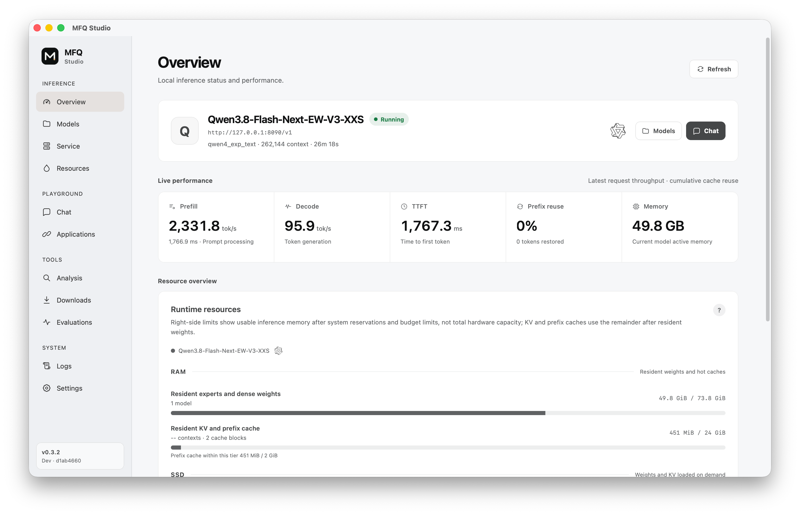

<div align="center">

# MFQ

<picture>
  <source media="(prefers-color-scheme: dark)" srcset="./docs/figures/tylogi-ai-lab-lockup-dark.svg">
  
</picture>

### Next-generation quantization & inference infrastructure

**Every Bit. Maximum Fidelity.**

MFQ combines neural-network-aware SQ and VQ formats designed to approach the
practical rate-distortion frontier, high-quality, fine-grained mixed-precision
calibration and quantization, and efficient CUDA, ROCm (HIP), and Metal
inference. The goal is
to deliver the best model quality possible on existing hardware within its
memory, storage, and latency limits.

<p>
  
  
  
</p>

<p>
  <strong>English</strong> · <a href="./README.zh-CN.md">中文</a>
</p>

<p>
  <a href="#quick-start">Quick start</a> ·
  <a href="#features">Features</a> ·
  <a href="#models">Models</a> ·
  <a href="#benchmarks">Benchmarks</a> ·
  <a href="./docs/README.md">Documentation</a>
</p>

</div>

## Quick start

### Use a prebuilt package

Download and load models, configure serving and memory budgets, inspect
quantization, and run benchmarks from one desktop app. Applications and agents
can connect through OpenAI- and Anthropic-compatible APIs.

<p align="center">
  
</p>

Download **MFQ Studio** from [Releases](https://github.com/Tylogi/MFQ/releases).
The package includes the desktop app, MFQ Server, and native runtime; no source
build is needed. Download a model from **Downloads**, then load it from
**Models**, or open an existing local `.mfq` checkpoint.

Prebuilt C++ workers can also be supplied directly to the server:

```bash
uv run mfq serve \
  --running-executable /path/to/mfq-decode-metal \
  --model /models/model.mfq
```

### Build from source

MFQ requires Git, [uv](https://docs.astral.sh/uv/), CMake 3.26+, and a
C++ toolchain. Use CUDA 12+ on NVIDIA systems, ROCm 6+ on AMD systems, or
Metal on Apple silicon.

```bash
git clone https://github.com/Tylogi/MFQ.git MFQ
cd MFQ

# NVIDIA / CUDA
uv sync
uv run mfq build --backend cuda

# AMD / ROCm (HIP)
uv sync
uv run mfq build --backend hip

# Apple silicon / Metal
uv sync --extra metal
uv run mfq build --backend metal
```

Start an empty local server and open <http://127.0.0.1:8090/>:

```bash
uv run mfq serve
```

Detailed requirements and custom CMake options are in the
[`mfq build` guide](./docs/cli/build.md).

## Quantize and run a model

Use the MFQ **`S4-M` mixed-precision preset**. It keeps sensitive tensors at
higher precision and leaves Vision and MTP components at source precision by
default.

```bash
# Quantization dependencies
uv sync --extra train

# Hugging Face safetensors -> self-contained MFQ
uv run mfq quantize \
  /models/Qwen3.8-27B \
  /models/Qwen3.8-27B-MFQ-S4-M.mfq \
  --preset S4-M \
  --backend auto
```

Load and serve the result:

```bash
uv sync                                # add --extra metal on Apple silicon
uv run mfq build --backend auto
uv run mfq serve \
  --model /models/Qwen3.8-27B-MFQ-S4-M.mfq \
  --context-size 32768
```

MFQ can also quantize full-precision MFQ and GGUF sources, consume per-tensor or
Expert-Wise precision maps and activation importance matrices, and write
sharded output. See
[`mfq quantize`](./docs/cli/quantize.md) and
[`mfq calibrate`](./docs/cli/calibrate.md).

## Features

### Quantization

- **Fine-Grained Quantization & Precision Virtualization.** Assign precision
  to individual experts, projections, chunks, or neurons within unified MFQ
  formats, retaining higher precision where the model needs it most.

- **High-Quality Calibrated Models & Rapid Architecture Support.** Download
  ready-to-run mixed-precision models, with quantization and inference support
  for new architectures added regularly.

Scalar NINT and vector NVQ formats can coexist within the same layer, with
independent choices for each expert's Gate, Up and Down projections. The
heatmaps below use **Qwen3.8-Flash-Next V3-XXS** as an example: the overall
expert average, followed by Gate, Up and Down, on a shared color scale.

<p align="center">
  
</p>

Our calibration method is open source; see
[Beyond Expert Rankings: Contrast Calibration for Mixed-Precision MoE Quantization](https://arxiv.org/abs/2610.20353).

### Inference

- **Production Inference & Serving.** Continuous Batching, multi-model loading
  with LRU management, tiered RAM/SSD Prefix and KV caches, and SSD-streamed
  experts let you serve multiple models and run MoE models beyond memory capacity.

- **High-Performance CUDA, ROCm & Metal Backends.** Optimized packed-weight,
  attention, cache, and I/O kernels for CUDA and Metal, with early ROCm/HIP
  support for dense Qwen3.5–3.8 models on MI300X. Optimized CPU backends are planned.

- **Efficient Fine-Grained Execution.** Heterogeneous expert fusion, grouped
  projection dispatch and format-aware kernels preserve fast inference when
  experts and projections use different formats and precisions.

- **Native Safetensors Loading.** Run supported raw-HF checkpoints directly,
  including DeepSeek V4.1 Flash, without first converting them to `.mfq`.

## Models

Published `.mfq` models are available from
[Hugging Face](https://huggingface.co/Tylogi) and
[ModelScope](https://www.modelscope.cn/profile/Tylogi).

| Model | Published precision families | Download |
| --- | --- | --- |
| Qwen3.8-Flash-Next | `V1-S`, `V1-M`, `S2-L`, `V3-XXS`, `S3-L`, `V4-XS`, `S4-L`, `S5-L` | [Hugging Face](https://huggingface.co/Tylogi/Qwen3.8-Flash-Next-EW-MFQ) · [ModelScope](https://www.modelscope.cn/models/Tylogi/Qwen3.8-Flash-Next-EW-MFQ) |
| DeepSeek-V4-Flash-0731 | Expert-Wise `V2` tiers | [Hugging Face](https://huggingface.co/Tylogi/DeepSeek-V4-Flash-0731-EW-MFQ) · [ModelScope](https://www.modelscope.cn/models/Tylogi/DeepSeek-V4-Flash-0731-EW-MFQ) |
| Qwen3.8-27B | `V1`–`V4`, `S4`–`S6` tiers | [ModelScope](https://www.modelscope.cn/models/Tylogi/Qwen3.8-27B-MFQ) |
| MiniCPM-o 4.5 | `S4`–`S8` multimodal tiers | [ModelScope](https://www.modelscope.cn/models/Tylogi/MiniCPM-o-4_5-MFQ) |

Supported architecture groups:

| Architecture group | Backends |
| --- | --- |
| Qwen3.5–3.8 | CUDA C++, Metal C++, HIP C++ (dense models) |
| Qwen Flash-Next / Qwen4-style | CUDA C++, Metal C++ |
| DeepSeek-V4-Flash Series | CUDA C++, Metal C++ |
| MiniCPM-o 4.5 | CUDA C++, Metal C++ |
| GLM5–5.3 | CUDA C++; Metal reference runtime |
| Gemma 4 | CUDA C++; Metal reference runtime |

See the [runtime support matrix](./docs/runtime-support.md) for details.

## Tools and APIs

| Surface | Purpose |
| --- | --- |
| **MFQ Studio** | Model downloads and loading, API and memory configuration, quantization analysis, benchmarks, and resource monitoring |
| `mfq build` | Detect the platform and compile the optimized CUDA or Metal C++ worker |
| `mfq quantize` | Apply uniform or mixed precision to HF, GGUF, or full-precision MFQ sources and write packed `.mfq` models |
| `mfq calibrate` / `mfq solve-ew` | Collect activation and loss-sensitivity data, score and validate packed candidates, and allocate precision to exact serialized-byte budgets |
| `mfq serve` | Run MFQ Server, Studio/Web UI, model workers, caches, and persistence |
| `mfq inspect` / `mfq optimize-layout` | Inspect containers and repack tensors into backend-optimized layouts |

MFQ exposes several interfaces for applications and tooling:

- **HTTP control API** under `/api/v1` for models, sessions, responses, jobs,
  datasets, evaluations, caches, and runtime state;
- **Server-Sent Events** for token and job streaming;
- **WebSocket realtime APIs** for audio and full-duplex sessions;
- **OpenAI-compatible `/v1/models` and `/v1/chat/completions` endpoints** from
  managed C++ workers and runtime adapters;
- **Anthropic-compatible `/v1/messages` endpoint** for applications and agents;
- **Function-tool calling** through the inference API; clients execute tools and return results.

Start with the [HTTP API](./docs/api/http.md),
[WebSocket API](./docs/api/websocket.md), or
[`mfq serve` reference](./docs/cli/serve.md).

## Benchmarks

### Qwen3.8-Flash-Next: local inference speed

#### Apple

| Tier | RAM Usage | Device | Input Size | Prompt Processing | Generation (no MTP) | Generation (MTP) | MTP Acceptance |
| :--- | ---: | :--- | ---: | ---: | ---: | ---: | ---: |
| [V1-M](https://huggingface.co/Tylogi/Qwen3.8-Flash-Next-EW-MFQ/tree/main/V1-M) | 42.91 GiB | Apple M5 Max · 40-core GPU · 128 GB | 4,096 tokens | 2,530.1 tok/s | 67.4 tok/s | 94.7 tok/s | 86.5% |
| [S2-L](https://huggingface.co/Tylogi/Qwen3.8-Flash-Next-EW-MFQ/tree/main/S2-L) | 46.95 GiB | Apple M5 Max · 40-core GPU · 128 GB | 4,096 tokens | 2,503.4 tok/s | 67.7 tok/s | 93.3 tok/s | 83.7% |
| [V3-XXS](https://huggingface.co/Tylogi/Qwen3.8-Flash-Next-EW-MFQ/tree/main/V3-XXS) | 49.85 GiB | Apple M5 Max · 40-core GPU · 128 GB | 4,096 tokens | 2,497.0 tok/s | 64.3 tok/s | 93.2 tok/s | 85.6% |
| [S3-L](https://huggingface.co/Tylogi/Qwen3.8-Flash-Next-EW-MFQ/tree/main/S3-L) | 57.50 GiB | Apple M5 Max · 40-core GPU · 128 GB | 4,096 tokens | 2,556.6 tok/s | 65.6 tok/s | 93.9 tok/s | 84.3% |
| [V4-XS](https://huggingface.co/Tylogi/Qwen3.8-Flash-Next-EW-MFQ/tree/main/V4-XS) | 61.02 GiB | Apple M5 Max · 40-core GPU · 128 GB | 4,096 tokens | 2,532.0 tok/s | 65.3 tok/s | 89.0 tok/s | 77.7% |
| [S4-L](https://huggingface.co/Tylogi/Qwen3.8-Flash-Next-EW-MFQ/tree/main/S4-L) | 78.19 GiB | Apple M5 Max · 40-core GPU · 128 GB | 4,096 tokens | 2,420.6 tok/s | 60.3 tok/s | 87.6 tok/s | 82.6% |

The PLE table stays on SSD; it does not need to occupy resident memory.
For example, V1-M downloads 72.44 GiB, including 29.54 GiB of PLE, while its
resident weights occupy 42.91 GiB.

### Qwen3.8-Flash-Next: model size vs. KLD and Top1

WikiText-2 evaluation: lower KLD is better; higher Top1 agreement with the
reference model is better.

<p align="center">
  
</p>

| MFQ Tier | Weight size (GB) | KLD ↓ | Top1 agreement ↑ |
| --- | ---: | ---: | ---: |
| `V1-S` | 72.536 | 0.22157 | 83.77% |
| `V1-M` | 74.529 | 0.19689 | 84.72% |
| `S2-L` | 78.859 | 0.14630 | 86.54% |
| `V3-XXS` | 81.952 | 0.12436 | 87.62% |
| `S3-L` | 89.976 | 0.08698 | 89.55% |
| `V4-XS` | 93.672 | 0.07524 | 90.36% |

At approximately 74.5 GB, **V1-M reduces KLD by 37.4% and improves Top1
agreement by 5.03 percentage points** over Unsloth UD IQ1_M.

Weight sizes in this comparison exclude the vision encoder and MTP head;
GB = 10⁹ bytes. See the [model card](https://huggingface.co/Tylogi/Qwen3.8-Flash-Next-EW-MFQ)
for the full comparison and tier selection guide.

## Documentation

- [Documentation index](./docs/README.md)
- [Build the C++ runtime](./docs/cli/build.md)
- [Quantize a model](./docs/cli/quantize.md)
- [Run MFQ Server](./docs/cli/serve.md)
- [Runtime support](./docs/runtime-support.md)
- [MiniCPM-o 4.5 multimodal runtime](./docs/minicpmo45.md)
- [Contributing and architecture rules](./CONTRIBUTING.md)

## Acknowledgements

MFQ is deeply inspired by and has learned from
[llama.cpp](https://github.com/ggml-org/llama.cpp),
[oMLX](https://github.com/jundot/omlx),
[MLX](https://github.com/ml-explore/mlx),
[PyTorch](https://github.com/pytorch/pytorch),
[Transformers](https://github.com/huggingface/transformers), and
[Unsloth](https://github.com/unslothai/unsloth).

MFQ is licensed under the [Apache License 2.0](./LICENSE).
