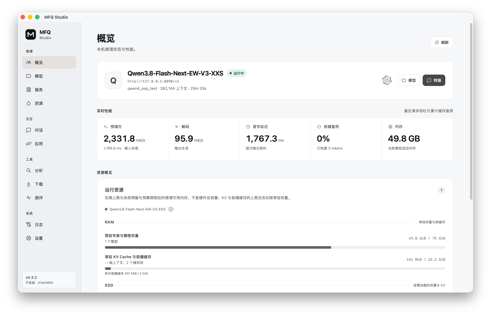
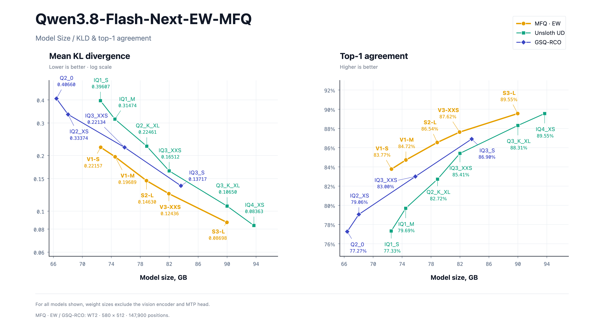

<div align="center">

# MFQ

<picture>
  <source media="(prefers-color-scheme: dark)" srcset="./docs/figures/tylogi-ai-lab-lockup-dark.svg">
  
</picture>

### 新一代量化与推理基础设施

**每一比特，极致保真。**

MFQ 将面向实用率失真前沿设计的神经网络感知 SQ/VQ 格式、高质量的
细粒度混合精度校准量化，以及高效的 CUDA 和 Metal 推理融为一体。
ROCm（HIP）支持仍在开发中。我们的目标是在内存、存储和延迟约束内，
让现有硬件运行尽可能高质量的模型。

<p>
  
  
  
</p>

<p>
  <a href="./README.md">English</a> · <strong>中文</strong>
</p>

<p>
  <a href="#快速开始">快速开始</a> ·
  <a href="#功能特性">功能特性</a> ·
  <a href="#模型">模型</a> ·
  <a href="#性能与质量">性能与质量</a> ·
  <a href="./docs/README.md">文档</a>
</p>

</div>

## 快速开始

### 使用预编译包

在一个桌面应用中下载和加载模型、配置服务与内存预算、分析量化精度、运行测评。
应用与 Agent 可以通过 OpenAI 和 Anthropic 兼容 API 接入。

<p align="center">
  
</p>

从 [Releases](https://github.com/Tylogi/MFQ/releases) 下载 **MFQ Studio**。
安装包包含桌面应用、MFQ Server 和原生运行时，无需从源码构建。在「下载」中
获取模型，再从「模型」中加载，也可以直接打开已有的本地 `.mfq` 检查点。

也可以直接为服务器指定预编译的 C++ worker：

```bash
uv run mfq serve \
  --running-executable /path/to/mfq-decode-metal \
  --model /models/model.mfq
```

### 从源码构建

MFQ 需要 Git、[uv](https://docs.astral.sh/uv/)、CMake 3.26+ 和 C++ 工具链。
NVIDIA 平台使用 CUDA 12+，Apple 芯片使用 Metal。ROCm/HIP 支持仍在开发中，
AMD 平台的实验性构建需要 ROCm 6+。

```bash
git clone https://github.com/Tylogi/MFQ.git MFQ
cd MFQ

# NVIDIA / CUDA
uv sync
uv run mfq build --backend cuda

# AMD / ROCm（HIP，开发中）
uv sync
uv run mfq build --backend hip

# Apple 芯片 / Metal
uv sync --extra metal
uv run mfq build --backend metal
```

启动一个暂未加载模型的本地服务器，并打开 <http://127.0.0.1:8090/>：

```bash
uv run mfq serve
```

更详细的环境要求和自定义 CMake 选项请参阅
[`mfq build` 指南](./docs/cli/build.md)。

## 量化并运行模型

使用 MFQ 的 **`S4-M` 混合精度预设**。它会为敏感张量保留更高精度，并默认
保持视觉和 MTP 组件的源精度。

```bash
# 量化依赖
uv sync --extra train

# Hugging Face safetensors -> 自包含 MFQ
uv run mfq quantize \
  /models/Qwen3.8-27B \
  /models/Qwen3.8-27B-MFQ-S4-M.mfq \
  --preset S4-M \
  --backend auto
```

加载并启动量化后的模型：

```bash
uv sync                                # Apple 芯片还需添加 --extra metal
uv run mfq build --backend auto
uv run mfq serve \
  --model /models/Qwen3.8-27B-MFQ-S4-M.mfq \
  --context-size 32768
```

MFQ 还可以量化满精度 MFQ 和 GGUF 源模型，读取逐张量或逐专家精度映射及激活
重要性矩阵，并输出分片模型。详见
[`mfq quantize`](./docs/cli/quantize.md) 和
[`mfq calibrate`](./docs/cli/calibrate.md)。

## 功能特性

### 量化

- **细粒度量化。** 在统一的 MFQ 格式中，按专家、投影、Chunk 或
  神经元分配精度，让敏感权重保留更高精度。

- **高质量校准模型与新架构支持。** 提供可直接使用的混合精度模型，并持续
  跟进新模型架构的量化与推理支持。

同一层内可以混用 NINT 标量与 NVQ 向量格式，每个专家的 Gate、Up、Down
投影都能独立选择格式和精度。下图以 **Qwen3.8-Flash-Next V3-XXS** 为例，
依次展示专家平均精度以及 Gate、Up、Down 精度，四张热力图使用同一色阶。

<p align="center">
  
</p>

我们的校准方法已开源，详见论文
[Beyond Expert Rankings: Contrast Calibration for Mixed-Precision MoE Quantization](https://arxiv.org/abs/2610.20353)。

### 推理

- **资源受限推理。** CUDA 侧联合使用 VRAM、RAM 和 SSD，运行超出显存容量
  的模型；Metal 侧支持 SSD Streaming，按需加载 MoE 专家与 PLE 表，降低
  统一内存的常驻需求。

- **生产级服务。** 支持连续批处理、带 LRU 的多模型管理及 RAM/SSD 分级
  前缀缓存与 KV Cache，通过 OpenAI 和 Anthropic 兼容 API 为应用与 Agent
  提供服务。

- **高性能 CUDA 与 Metal 后端。** 为 CUDA 与 Metal 优化打包权重、
  注意力、缓存与 I/O 内核。ROCm/HIP 支持仍在开发中，优化的 CPU 后端正在规划中。

## 模型

已发布的 `.mfq` 模型可从
[Hugging Face](https://huggingface.co/Tylogi) 和
[ModelScope](https://www.modelscope.cn/profile/Tylogi) 下载。

| 模型 | 已发布精度系列 | 下载 |
| --- | --- | --- |
| Qwen3.8-Flash-Next | `V1-S`、`V1-M`、`S2-L`、`V3-XXS`、`S3-L`、`V4-XS`、`S4-L`、`S5-L` | [Hugging Face](https://huggingface.co/Tylogi/Qwen3.8-Flash-Next-EW-MFQ) · [ModelScope](https://www.modelscope.cn/models/Tylogi/Qwen3.8-Flash-Next-EW-MFQ) |
| DeepSeek-V4-Flash-0731 | 逐专家 `V2` 档位 | [Hugging Face](https://huggingface.co/Tylogi/DeepSeek-V4-Flash-0731-EW-MFQ) · [ModelScope](https://www.modelscope.cn/models/Tylogi/DeepSeek-V4-Flash-0731-EW-MFQ) |
| Qwen3.8-27B | `V1`–`V4`、`S4`–`S6` 档位 | [ModelScope](https://www.modelscope.cn/models/Tylogi/Qwen3.8-27B-MFQ) |
| MiniCPM-o 4.5 | `S4`–`S8` 多模态档位 | [ModelScope](https://www.modelscope.cn/models/Tylogi/MiniCPM-o-4_5-MFQ) |

支持的架构系列：

| 架构系列 | 后端 |
| --- | --- |
| Qwen3.5–3.8 | CUDA C++、Metal C++、HIP C++（稠密模型，开发中） |
| Qwen Flash-Next / Qwen4 风格 | CUDA C++、Metal C++ |
| DeepSeek-V4-Flash Series | CUDA C++、Metal C++ |
| MiniCPM-o 4.5 | CUDA C++、Metal C++ |
| GLM5–5.3 | CUDA C++；Metal 参考运行时 |
| Gemma 4 | CUDA C++；Metal 参考运行时 |

详细支持范围见[运行时支持矩阵](./docs/runtime-support.md)。

## 性能与质量

### Qwen3.8-Flash-Next：本地推理速度

#### Apple

| 档位 | 内存占用 | 设备 | 输入长度 | 提示词处理 | 生成（无 MTP） | 生成（MTP） | MTP 接受率 |
| :--- | ---: | :--- | ---: | ---: | ---: | ---: | ---: |
| [V1-M](https://huggingface.co/Tylogi/Qwen3.8-Flash-Next-EW-MFQ/tree/main/V1-M) | 43.36 GiB | Apple M5 Max · 40 核 GPU · 128 GB | 4,096 tokens | 2,538.5 tok/s | 71.6 tok/s | 101.2 tok/s | 88.5% |
| [S2-L](https://huggingface.co/Tylogi/Qwen3.8-Flash-Next-EW-MFQ/tree/main/S2-L) | 47.41 GiB | Apple M5 Max · 40 核 GPU · 128 GB | 4,096 tokens | 2,538.9 tok/s | 71.0 tok/s | 97.9 tok/s | 83.5% |
| [V3-XXS](https://huggingface.co/Tylogi/Qwen3.8-Flash-Next-EW-MFQ/tree/main/V3-XXS) | 50.33 GiB | Apple M5 Max · 40 核 GPU · 128 GB | 4,096 tokens | 2,527.6 tok/s | 70.8 tok/s | 105.4 tok/s | 92.9% |
| [S3-L](https://huggingface.co/Tylogi/Qwen3.8-Flash-Next-EW-MFQ/tree/main/S3-L) | 57.95 GiB | Apple M5 Max · 40 核 GPU · 128 GB | 4,096 tokens | 2,565.6 tok/s | 68.1 tok/s | 98.2 tok/s | 81.7% |
| [V4-XS](https://huggingface.co/Tylogi/Qwen3.8-Flash-Next-EW-MFQ/tree/main/V4-XS) | 61.48 GiB | Apple M5 Max · 40 核 GPU · 128 GB | 4,096 tokens | 2,540.1 tok/s | 67.7 tok/s | 96.7 tok/s | 84.1% |
| [S4-L](https://huggingface.co/Tylogi/Qwen3.8-Flash-Next-EW-MFQ/tree/main/S4-L) | 78.25 GiB | Apple M5 Max · 40 核 GPU · 128 GB | 4,096 tokens | 2,481.7 tok/s | 63.6 tok/s | 93.6 tok/s | 82.6% |

PLE 表按需从 SSD 读取，无需常驻内存。例如，V1-M 下载大小为 72.44 GiB，
其中 PLE 表占 29.54 GiB，实际常驻权重为 43.36 GiB。

### Qwen3.8-Flash-Next：模型大小与 KLD、Top1

WikiText-2 评测：KLD 越低越好，与参考模型的 Top1 一致率越高越好。

<p align="center">
  
</p>

| MFQ 档位 | 权重大小（GB） | KLD ↓ | Top1 一致率 ↑ |
| --- | ---: | ---: | ---: |
| `V1-S` | 72.536 | 0.22157 | 83.77% |
| `V1-M` | 74.529 | 0.19689 | 84.72% |
| `S2-L` | 78.859 | 0.14630 | 86.54% |
| `V3-XXS` | 81.952 | 0.12436 | 87.62% |
| `S3-L` | 89.976 | 0.08698 | 89.55% |
| `V4-XS` | 93.672 | 0.07524 | 90.36% |

在约 74.5 GB 大小时，相比 Unsloth UD IQ1_M，**V1-M 的 KLD 降低 37.4%，
Top1 一致率提高 5.03 个百分点**。

本项质量对比中的权重大小不含视觉编码器与 MTP 层，GB = 10⁹ 字节。
完整对比与档位选择建议见[模型卡](https://huggingface.co/Tylogi/Qwen3.8-Flash-Next-EW-MFQ)。

## 文档

- [文档索引](./docs/README.md)
- [构建 C++ 运行时](./docs/cli/build.md)
- [量化模型](./docs/cli/quantize.md)
- [运行 MFQ Server](./docs/cli/serve.md)
- [HTTP API](./docs/api/http.md)
- [WebSocket 与实时 API](./docs/api/websocket.md)
- [运行时支持范围](./docs/runtime-support.md)
- [MiniCPM-o 4.5 多模态运行时](./docs/minicpmo45.md)
- [贡献指南与架构规范](./CONTRIBUTING.md)

## 致谢

MFQ 深受以下项目启发，并从中学习：
[llama.cpp](https://github.com/ggml-org/llama.cpp)、
[oMLX](https://github.com/jundot/omlx)、
[MLX](https://github.com/ml-explore/mlx)、
[PyTorch](https://github.com/pytorch/pytorch)、
[Transformers](https://github.com/huggingface/transformers) 和
[Unsloth](https://github.com/unslothai/unsloth)。

MFQ 使用 [Apache License 2.0](./LICENSE) 许可证。
